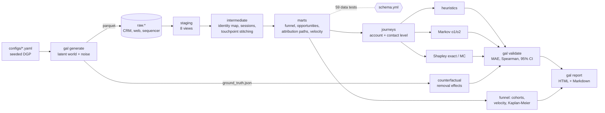

# gtm-attribution-lab

**A B2B multi-touch attribution and funnel-analytics engine, tested against synthetic buyer journeys where the true answer is known.**

> **All data here is synthetic.** It comes from a seeded simulator with a known causal ground truth. Every number below was measured from runs in this repo (`results/`, `reports/`). None of it describes a real company.

`Python 3.11+` · `DuckDB` · `dbt-style SQL layers` · `Markov chains` · `Shapley values` · `Kaplan-Meier` · `90 tests (incl. Hypothesis property tests)` · `ruff + mypy --strict clean`

---

## 1. The problem: last-touch lies

Ask a B2B GTM team which channel "drove" a closed-won deal and the CRM usually answers with the **last touch** before the deal moved. That is often an SDR call or a branded Google search. Those touches happen late because the buyer was already in-market. They are not necessarily why the buyer got there.

Teams then move budget toward the channels that happen to sit at the end of the journey. Data-driven models (Markov, Shapley) get sold as the fix, but nobody can say how wrong *any* of these models is on their own data, because the real causal effect of a channel is never observed.

This project builds a world where it **is** observed, and then scores every model against it.

## 2. What I built

| Layer | What it does |
|---|---|
| **Synthetic world** (`gal.generator`) | 3,000 accounts with buying committees of 2–8 people and seven channels (outbound email, LinkedIn, paid, webinar, organic, SDR call, events). Each channel has a configured **true per-touch lift on each funnel stage** (lead→MQL→SQL→opp→won). Noise is realistic: a hidden *intent* confounder, ABM-driven channel correlation, late-journey channels, CRM stage-recording lag, missing UTMs, anonymous web sessions, unlinked contacts. Everything is seeded and set in YAML. |
| **Ground truth** | The *counterfactual* number of wins lost if a channel's touches are deleted. It is estimated by re-running the stage machine with common random numbers over 48 replicates. |
| **Warehouse** (`models/`, `gal.warehouse`) | 21 DuckDB SQL models in `staging → intermediate → marts` layers, run by a small dbt-style runner (`ref`/`source`/`var`, topological sort, cycle detection). It also runs **59 data tests** (`not_null`, `unique`, `accepted_values`, `relationships`, `expression_is_true`). The SQL covers sessionisation, identity stitching (anonymous ID → contact → account, with an email-domain fallback), attribution windows and funnel marts. |
| **Attribution** (`gal.attribution`) | First/last touch, linear, time-decay, U-shaped, W-shaped, **Markov removal effect** (order 1 and 2), **Shapley** (exact up to 10 channels, Monte-Carlo with standard errors beyond that, plus a convergence check). Every model runs at **account level** and **contact level**. |
| **Validation** (`gal.validation`) | MAE and Spearman ρ between model credit shares and true incremental shares, across 8 seeds × 3 confounding levels, with 95% t-intervals. It also runs a **positive-control world** to test the engine itself. |
| **Funnel analytics** (`gal.funnel`, marts) | Stage conversion by monthly cohort, pipeline velocity, and Kaplan-Meier time-to-stage curves with Greenwood bands. |
| **Output** | Self-contained `reports/report.html` (base64 charts), `reports/report.md`, CSVs in `results/`, and the CLI `gal generate | build | attribute | validate | report`. |

## 3. Architecture



## 4. The models, in plain words

| Model | Rule | What it assumes |
|---|---|---|
| First touch | 100% to the touch that started the journey | Awareness is everything |
| Last touch | 100% to the final touch before the win | The closer is everything |
| Linear | Equal split across all touches | Every touch matters equally |
| Time decay | Weight halves every 14 days back from the win | Recent touches matter more |
| U-shaped | 40% first, 40% last, 20% spread in between | Opening and closing matter most |
| W-shaped | 30% each to first touch, the touch at MQL and the touch at opportunity creation, 10% to the rest | The funnel milestones matter most |
| Markov (removal effect) | Fit a chain of channel-to-channel transitions. Credit = how much the conversion probability drops if a channel is removed from the chain | A channel's value is the paths that run through it |
| Shapley (empirical) | Game theory: average marginal value of a channel across all channel combinations, where the value of a combination is the conversion rate of journeys with exactly that channel set | The value of a combination can be read off the data |
| Shapley (model-based) | Same game, but values come from a logistic conversion model on touch counts, per journey (SHAP-style) | Response is additive in touch counts on the log-odds scale |

Data-driven models compare converting journeys with non-converting ones. Non-converting journeys keep collecting touches until the data cutoff, so they get **horizon-matched**: each one is cut at a lead-to-win duration sampled from the converters ([ADR 0003](docs/adr/0003-attribution-model-design-choices.md)).

## 5. Validation results (synthetic, measured)

Realistic world (`configs/default.yaml`): 3,000 accounts per run, 167–248 wins per run, 8 seeds per confounding level. The numbers are account-level MAE of channel shares (lower is better), with 95% CI. `uniform` gives every channel 1/7 and is the "know nothing" reference.

| Model | MAE, no confounding | MAE, confounding 0.6 | MAE, confounding 1.2 | Spearman ρ (0 → 0.6 → 1.2) |
|---|---|---|---|---|
| last_touch | **0.081** [0.076, 0.086] | 0.088 [0.080, 0.096] | 0.087 [0.081, 0.092] | 0.12 → 0.23 → 0.23 |
| time_decay | 0.083 [0.079, 0.087] | 0.094 [0.091, 0.097] | 0.095 [0.092, 0.099] | −0.09 → 0.05 → −0.05 |
| shapley_model | 0.088 [0.065, 0.111] | 0.111 [0.094, 0.128] | 0.101 [0.084, 0.118] | **0.59** → −0.10 → 0.05 |
| *uniform (reference)* | *0.090* | *0.091* | *0.090* | n/a |
| shapley_empirical | 0.097 [0.074, 0.119] | 0.098 [0.085, 0.111] | 0.098 [0.093, 0.103] | 0.28 → −0.28 → −0.17 |
| markov_o2 | 0.103 [0.100, 0.105] | 0.107 [0.105, 0.109] | 0.108 [0.107, 0.110] | −0.57 → −0.55 → −0.55 |
| markov_o1 | 0.104 [0.102, 0.106] | 0.110 [0.108, 0.112] | 0.112 [0.111, 0.113] | −0.58 → −0.63 → −0.58 |
| u_shaped | 0.117 | 0.119 | 0.120 | −0.47 → −0.55 → −0.47 |
| w_shaped | 0.123 | 0.130 | 0.128 | −0.26 → −0.50 → −0.39 |
| linear | 0.128 | 0.130 | 0.131 | −0.50 → −0.53 → −0.55 |
| first_touch | 0.178 | 0.189 | 0.193 | −0.37 → −0.62 → −0.57 |

Positive control (`configs/positive_control.yaml`: no confounding, no tracking noise, one effective funnel transition, 5 seeds):

| Model | MAE [95% CI] | Spearman ρ |
|---|---|---|
| last_touch | 0.005 [0.003, 0.007] | 0.985 |
| shapley_model | 0.037 [0.022, 0.051] | 0.91 |
| shapley_empirical | 0.052 [0.039, 0.066] | 0.89 |
| *uniform* | *0.110* | n/a |
| markov_o1 | 0.123 [0.121, 0.125] | −0.65 |

What the runs show:

1. **Last touch can have the lowest error and still point budget the wrong way.** Organic search has **zero** true effect in this world, yet last touch gives it 17% → 20% → 21% of credit as confounding rises. Webinars carry the largest true share (27–28%) and get only about 10%. A low average error hides a wrong ranking (ρ ≈ 0.1–0.2).
2. **No model beats "split it evenly" by much once the world is realistic.** Across all three confounding levels, only last touch and time decay at zero confounding have CIs entirely below `uniform` (0.081 and 0.083 vs 0.090). Once intent confounding is switched on, no model's CI clears it. That is the core argument for incrementality tests.
3. **Model-based Shapley ranks channels best when exposure is unconfounded (ρ = 0.59), then breaks down under confounding** (ρ ≈ 0). Its credit to organic goes from 5% to 16–23%, because in-market buyers both search more and convert more.
4. **The Markov removal effect tracks touch volume, not incrementality.** ρ stays between −0.55 and −0.63 at every level, and it also loses to `uniform` in the positive control. Removing a channel that sits on 90% of paths kills 90% of paths, whatever that channel's real lift.
5. **The engine itself is sound.** In the positive control, last touch (0.005) and Shapley (0.037–0.052) recover the truth. The realistic world is what breaks them, not a bug.
6. **Account-level vs contact-level made little difference here** (e.g. last touch 0.088 vs 0.083 at confounding 0.6). Following only the primary contact drops committee touches, but it also drops noise. This simulator doesn't support a claim that one level is always better.

Shapley Monte-Carlo convergence: mean error against exact values falls from 7.2e-4 at 10 permutations to 3.0e-5 at 3,000, in line with the expected 1/√m rate (`reports/figures/shapley_convergence.png`).

Full tables, per-run shares and charts are in [`reports/report.md`](reports/report.md) and the self-contained [`reports/report.html`](reports/report.html).

## 6. Which model to trust when

| Situation | Use | Why (from the runs above) |
|---|---|---|
| Sales-led motion, the touch that closes really does trigger the win | Last touch, read **with** its ranking caveat | Near-perfect in the positive control; lowest MAE in the realistic world, but it over-credits demand-capture channels |
| You need a channel *ranking* for planning and exposure isn't driven by intent (e.g. scheduled programs, randomised outreach) | Model-based Shapley | Best rank correlation without confounding (ρ = 0.59) |
| Retargeting, branded search or SDR follow-up chases in-market accounts | None of them alone. Run holdouts or geo/account-level lift tests | Every observational model drifted toward confounded channels |
| Executive dashboard needs "one number per channel" | Show 2–3 models side by side, with the spread | The spread between models is about as large as each model's error |
| Markov removal effect | Path-coverage diagnostic, not budget allocation | Negative rank correlation with truth at every confounding level |

## 7. Funnel analytics (demo run: seed 42, confounding 0.6)

- **Identity resolution:** 76% of 27,759 web sessions were stitched to a known contact. 2,108 contacts reached their account only through the email-domain fallback, and 1,207 stayed unresolved.
- **Pipeline velocity** = (# opportunities × win rate × average won ACV) / average days from opportunity creation to closed-won. All-time: 387 opps × 0.643 × $63,364 / 36.5 days ≈ **$432,600/day**. Win rate counts closed deals only. In this simulator losses close later than wins, so the most recent quarter's win rate (0.756) is biased upward. The report shows the quarterly breakdown so that bias stays visible.
- **Kaplan-Meier time-to-stage:** 28% of leads reach MQL by day 90 and 49% by day 180 (median 183 days). Leads that haven't converted by the cutoff are censored rather than counted as failures, so young cohorts don't drag the curve down.

## 8. Quickstart

```bash
python -m venv .venv && source .venv/bin/activate
make install          # pip install -e ".[dev]"
make check            # ruff + mypy + 90 pytest tests

gal generate -c configs/default.yaml -o data/raw     # synthetic raw tables + ground truth
gal build --raw data/raw --db data/warehouse.duckdb  # 21 models, 59 data tests
gal attribute --raw data/raw --db data/warehouse.duckdb -o results/attribution.csv
gal validate -c configs/default.yaml --n-seeds 8 --confounding 0,0.6,1.2 -o results/validation
gal validate -c configs/positive_control.yaml --n-seeds 5 -o results/positive_control
gal report --raw data/raw --db data/warehouse.duckdb --attribution results/attribution.csv \
  --validation results/validation --control results/positive_control -o reports

make demo             # all of the above (about 6 minutes on a laptop)
```

Repository layout: `src/gal/` (generator, warehouse runner, attribution, funnel, stats, validation, report, CLI) · `models/` (SQL + `schema.yml`) · `configs/` · `tests/` · `docs/adr/` · `results/` and `reports/` (committed outputs from the runs quoted above).

## 9. Limitations

- **Synthetic ≠ causal proof on real data.** The results show how models behave *under this data-generating process*. A different DGP (other lifts, stronger interactions, real seasonality) can reorder the models. The value is in the method: the same harness can score a model against any world you can write down.
- Ground truth is a Monte-Carlo estimate (48 replicates), so zero-lift channels can show tiny non-zero effects. Negative estimates are clipped before computing shares.
- Exposure is scheduled before progression is simulated. That keeps the counterfactual exact, but it means the simulator has no "SDR calls because the lead became an MQL" feedback loop. Real data has that loop, and it would hurt last touch further.
- Shares are compared over tracked channels. Credit that models give to `direct` (12–15% on average across models) has no ground truth and is reported separately.
- Kaplan-Meier treats dead deals as censored (no competing-risks model), so 1 − S(t) is an upper bound on the reach rate.
- The Shapley logistic model is additive in touch counts. It cannot represent stage-specific effects such as "SDR calls only help after MQL", which is part of why it degrades in the realistic world.

## 10. Roadmap

- Lift-test calibration: simulate account-level holdouts and calibrate model credits to the measured lift (MMM/MTA triangulation).
- Stage-aware models: a discrete-time hazard model per funnel transition, scored with the same harness.
- Feedback-loop DGP: exposure that reacts to stage (SDR follow-up after MQL), with a sequential counterfactual.
- Competing-risks funnel (Aalen-Johansen) and velocity by segment.
- Port `models/` to dbt-duckdb and add a Streamlit explorer on top of the marts.

## Design decisions

- [ADR 0001: synthetic world with counterfactual ground truth](docs/adr/0001-synthetic-world-with-counterfactual-ground-truth.md)
- [ADR 0002: a dbt-style runner on DuckDB](docs/adr/0002-dbt-style-runner-on-duckdb.md)
- [ADR 0003: attribution model design choices](docs/adr/0003-attribution-model-design-choices.md)

## License

MIT © 2026 Hussain Singapuri
