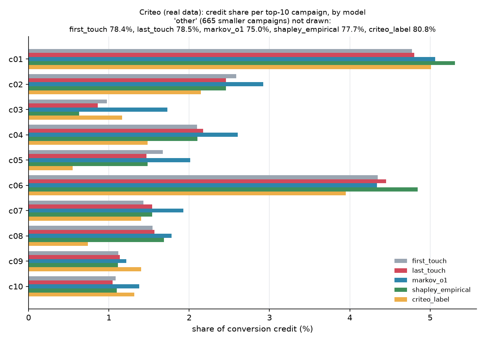

# Attribution models on real data: Criteo (16.5M impressions)

> **Real, public data. No ground truth.** Source: Criteo Attribution Modeling for Bidding dataset (Diemert et al. 2017, [arXiv:1707.06409](https://arxiv.org/abs/1707.06409)), [Hugging Face](https://huggingface.co/datasets/criteo/criteo-attribution-dataset), licence CC BY-NC-SA 4.0. Every number here is written by `scripts/run_criteo.py`.

## Data and journeys

- Impressions: **16,468,027**; users: **6,142,256**; campaigns: **675**; clicks: 5,947,563.
- Conversion events (distinct user × conversion_id): **438,730** (435,810 distinct conversion_ids). Criteo's own `attribution` label credits 237,157 of them (54.1%) to Criteo.
- Journeys: each user's impressions are cut at every conversion (ASOF join on time). 438,730 converting journeys (mean 3.90 touches; 2,368 are empty because a same-timestamp conversion took the touches) and 5,955,915 non-converting journeys (49,502 unique channel paths).
- Channels: the top **K = 10** campaigns by impressions (`c01` = largest) plus `other` for the remaining 665. The top 10 hold 18.6% of impressions. A small K keeps exact Shapley values and a dense order-2 Markov chain tractable.
- Only **41,296** converting journeys (9.4%) touch more than one channel. On the rest every model must agree, so all disagreement below comes from that multi-channel minority.
- Criteo's conversion labels are campaign-specific: only 2,859 of 435,810 conversion_ids (0.66%) carry impressions from more than one campaign. A user-level journey can therefore mix campaigns (likely different advertisers) that never shared a conversion label. In 2.2% of non-empty converting journeys the last touch is a different channel from the campaign that owns the conversion_id.
- Settings: time-decay half-life 7 days; Markov order 1 and 2; Shapley exact over each journey's channel set; no horizon matching (the dataset has no lead-creation time). W-shaped is skipped: there are no MQL/opportunity milestones in display-ad data.

## Credit share per channel (% of all conversion credit)

| channel | campaign id | first_touch | last_touch | linear | time_decay | u_shaped | markov_o1 | markov_o2 | shapley_empirical | shapley_model | criteo_label |
|---|---|---|---|---|---|---|---|---|---|---|---|
| c01 | 10341182 | 4.77% | 4.80% | 4.79% | 4.79% | 4.79% | 5.06% | 5.11% | 5.31% | 5.03% | 5.01% |
| c02 | 30801593 | 2.59% | 2.46% | 2.52% | 2.50% | 2.52% | 2.92% | 2.89% | 2.46% | 2.61% | 2.14% |
| c03 | 17686799 | 0.98% | 0.86% | 0.93% | 0.91% | 0.92% | 1.73% | 1.62% | 0.63% | 0.51% | 1.16% |
| c04 | 15398570 | 2.10% | 2.17% | 2.15% | 2.17% | 2.14% | 2.60% | 2.56% | 2.10% | 2.18% | 1.48% |
| c05 | 5061834 | 1.67% | 1.47% | 1.59% | 1.56% | 1.58% | 2.01% | 2.09% | 1.48% | 1.55% | 0.55% |
| c06 | 15184511 | 4.35% | 4.45% | 4.39% | 4.42% | 4.40% | 4.34% | 4.41% | 4.84% | 4.65% | 3.95% |
| c07 | 29427842 | 1.43% | 1.54% | 1.50% | 1.53% | 1.49% | 1.93% | 1.95% | 1.54% | 1.61% | 1.40% |
| c08 | 28351001 | 1.54% | 1.57% | 1.56% | 1.56% | 1.56% | 1.78% | 1.76% | 1.68% | 1.59% | 0.74% |
| c09 | 18975823 | 1.12% | 1.13% | 1.13% | 1.14% | 1.13% | 1.22% | 1.20% | 1.11% | 1.12% | 1.40% |
| c10 | 31772643 | 1.08% | 1.05% | 1.07% | 1.07% | 1.07% | 1.38% | 1.43% | 1.10% | 1.16% | 1.32% |
| other | 665 others | 78.37% | 78.49% | 78.37% | 78.37% | 78.41% | 75.03% | 74.98% | 77.74% | 77.98% | 80.85% |

`criteo_label` = share of Criteo-attributed conversions whose last attributed click was on that channel (Criteo's own last-click attribution). Model shares are over all conversions with at least one touch.

## How far the models disagree

Gap = share(a) − share(b) in percentage points. Total variation = share of all credit that would have to move to turn one model's split into the other's. Spearman ρ is over the 11 channel shares.

| a vs b | max abs gap | on channel | max abs gap, top-10 only | a over-credits most | a under-credits most | total variation | Spearman ρ |
|---|---|---|---|---|---|---|---|
| last_touch vs markov_o1 | +3.46 pp | other | +0.87 pp (c03) | other (+3.46 pp) | c03 (-0.87 pp) | 3.58% | 0.927 |
| last_touch vs markov_o2 | +3.52 pp | other | +0.76 pp (c03) | other (+3.52 pp) | c03 (-0.76 pp) | 3.56% | 0.927 |
| last_touch vs shapley_empirical | +0.75 pp | other | +0.51 pp (c01) | other (+0.75 pp) | c01 (-0.51 pp) | 1.08% | 1.000 |
| last_touch vs shapley_model | +0.51 pp | other | +0.35 pp (c03) | other (+0.51 pp) | c01 (-0.23 pp) | 0.88% | 0.982 |
| markov_o1 vs shapley_empirical | +2.71 pp | other | +1.10 pp (c03) | c03 (+1.10 pp) | other (-2.71 pp) | 3.47% | 0.927 |
| first_touch vs last_touch | +0.20 pp | c05 | +0.20 pp (c05) | c05 (+0.20 pp) | other (-0.12 pp) | 0.49% | 0.973 |
| criteo_label vs last_touch | +2.35 pp | other | +0.92 pp (c05) | other (+2.35 pp) | c05 (-0.92 pp) | 3.40% | 0.809 |
| criteo_label vs markov_o1 | +5.82 pp | other | +1.47 pp (c05) | other (+5.82 pp) | c05 (-1.47 pp) | 6.00% | 0.736 |
| criteo_label vs shapley_empirical | +3.10 pp | other | +0.95 pp (c08) | other (+3.10 pp) | c08 (-0.95 pp) | 4.15% | 0.809 |

### Bootstrap 95% intervals (30 Poisson replicates over users)

| a vs b | max abs gap [95% CI] | max abs gap, top-10 only [95% CI] | total variation [95% CI] | Spearman ρ [95% CI] |
|---|---|---|---|---|
| last_touch vs markov_o1 | +3.46 pp [3.42, 3.49] | +0.87 pp [0.86, 0.88] | 3.58% [3.55, 3.60] | 0.927 [0.920, 0.936] |
| last_touch vs shapley_empirical | +0.75 pp [0.71, 0.80] | +0.51 pp [0.49, 0.53] | 1.08% [1.05, 1.13] | 1.000 [0.982, 1.000] |
| markov_o1 vs shapley_empirical | +2.71 pp [2.64, 2.78] | +1.10 pp [1.08, 1.12] | 3.47% [3.42, 3.51] | 0.927 [0.915, 0.936] |
| criteo_label vs last_touch | +2.35 pp [2.27, 2.50] | +0.92 pp [0.90, 0.95] | 3.40% [3.32, 3.52] | 0.809 [0.809, 0.864] |
| criteo_label vs markov_o1 | +5.82 pp [5.72, 5.96] | +1.47 pp [1.44, 1.49] | 6.00% [5.91, 6.17] | 0.736 [0.736, 0.782] |

Per-channel gap, last touch minus Markov order 1 and minus empirical Shapley (pp, point [95% CI]):

| channel | last − markov_o1 | last − shapley_empirical | last / markov_o1 credit |
|---|---|---|---|
| c01 | -0.26 pp [-0.27, -0.25] | -0.51 pp [-0.53, -0.49] | 0.95× |
| c02 | -0.46 pp [-0.47, -0.46] | +0.00 pp [-0.01, 0.02] | 0.84× |
| c03 | -0.87 pp [-0.88, -0.86] | +0.23 pp [0.22, 0.24] | 0.50× |
| c04 | -0.43 pp [-0.44, -0.42] | +0.07 pp [0.06, 0.09] | 0.84× |
| c05 | -0.54 pp [-0.55, -0.54] | -0.01 pp [-0.03, 0.01] | 0.73× |
| c06 | +0.12 pp [0.11, 0.13] | -0.39 pp [-0.41, -0.38] | 1.03× |
| c07 | -0.39 pp [-0.40, -0.38] | +0.00 pp [-0.01, 0.02] | 0.80× |
| c08 | -0.21 pp [-0.22, -0.21] | -0.12 pp [-0.13, -0.10] | 0.88× |
| c09 | -0.08 pp [-0.08, -0.08] | +0.02 pp [0.01, 0.03] | 0.93× |
| c10 | -0.33 pp [-0.33, -0.33] | -0.05 pp [-0.07, -0.04] | 0.76× |
| other | +3.46 pp [3.42, 3.49] | +0.75 pp [0.71, 0.80] | 1.05× |

## Spearman ρ between models (channel shares)

| | first_touch | last_touch | linear | time_decay | u_shaped | markov_o1 | markov_o2 | shapley_empirical | shapley_model | criteo_label |
|---|---|---|---|---|---|---|---|---|---|---|
| first_touch | 1.00 | 0.97 | 1.00 | 0.99 | 1.00 | 0.95 | 0.95 | 0.97 | 0.95 | 0.76 |
| last_touch | 0.97 | 1.00 | 0.97 | 0.99 | 0.97 | 0.93 | 0.93 | 1.00 | 0.98 | 0.81 |
| linear | 1.00 | 0.97 | 1.00 | 0.99 | 1.00 | 0.95 | 0.95 | 0.97 | 0.95 | 0.76 |
| time_decay | 0.99 | 0.99 | 0.99 | 1.00 | 0.99 | 0.94 | 0.94 | 0.99 | 0.96 | 0.77 |
| u_shaped | 1.00 | 0.97 | 1.00 | 0.99 | 1.00 | 0.95 | 0.95 | 0.97 | 0.95 | 0.76 |
| markov_o1 | 0.95 | 0.93 | 0.95 | 0.94 | 0.95 | 1.00 | 1.00 | 0.93 | 0.95 | 0.74 |
| markov_o2 | 0.95 | 0.93 | 0.95 | 0.94 | 0.95 | 1.00 | 1.00 | 0.93 | 0.95 | 0.74 |
| shapley_empirical | 0.97 | 1.00 | 0.97 | 0.99 | 0.97 | 0.93 | 0.93 | 1.00 | 0.98 | 0.81 |
| shapley_model | 0.95 | 0.98 | 0.95 | 0.96 | 0.95 | 0.95 | 0.95 | 0.98 | 1.00 | 0.82 |
| criteo_label | 0.76 | 0.81 | 0.76 | 0.77 | 0.76 | 0.74 | 0.74 | 0.81 | 0.82 | 1.00 |

## Variant: channel = click vs view

Same journeys, but every impression is labelled `click` or `view` instead of by campaign. Share of conversion credit given to clicked impressions:

| model | click share | view share |
|---|---|---|
| first_touch | 67.8% | 32.2% |
| last_touch | 79.7% | 20.3% |
| linear | 71.8% | 28.2% |
| time_decay | 73.7% | 26.3% |
| u_shaped | 73.0% | 27.0% |
| markov_o1 | 60.9% | 39.1% |
| markov_o2 | 63.5% | 36.5% |
| shapley_empirical | 99.8% | 0.2% |
| shapley_model | 99.8% | 0.2% |

435,810 of 435,810 conversion_ids have at least one clicked impression (the dataset tracks post-click conversions), so click-based rules have a built-in advantage here.

## What this does and does not show

- There is no causal ground truth in this dataset. These numbers show how far the models disagree on real journeys, and how close each is to Criteo's own last-click label. They cannot say which model is right. The synthetic lab in this repo is what scores models against a known truth.
- `other` bundles 665 campaigns and dominates every model's split, so the top-10 campaign shares are small in absolute terms; relative differences (last/markov ratio) are the clearer signal.
- Journeys cross campaigns that probably belong to different advertisers. Crediting a conversion to another advertiser's campaign is a modelling artefact of user-level journeys, not evidence that the campaign caused it.
- Non-converting journeys are right-censored at the end of the 30-day window and are not horizon-matched.
- Bootstrap intervals resample users (Poisson weights) and hold the top-K channel set fixed. They cover sampling noise, not model or definition choices.

Runtime: 1017 s (30 bootstrap replicates).
