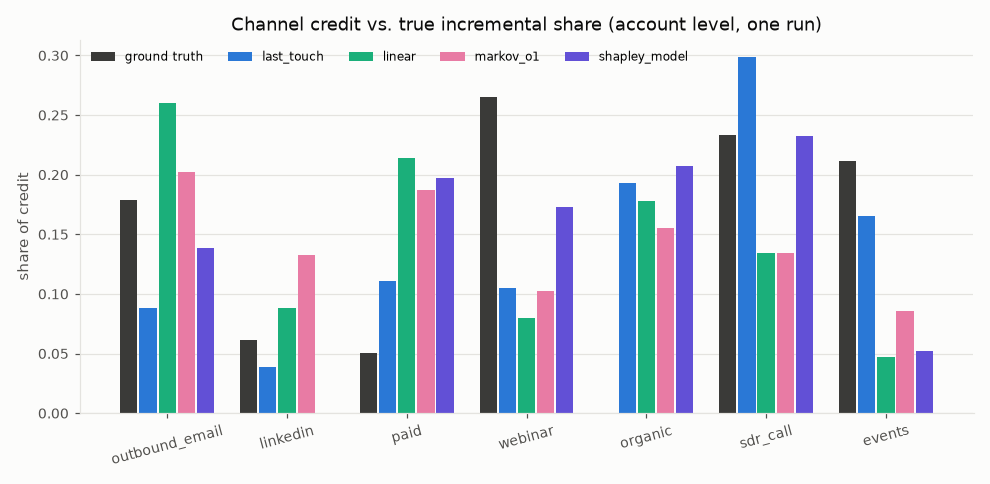
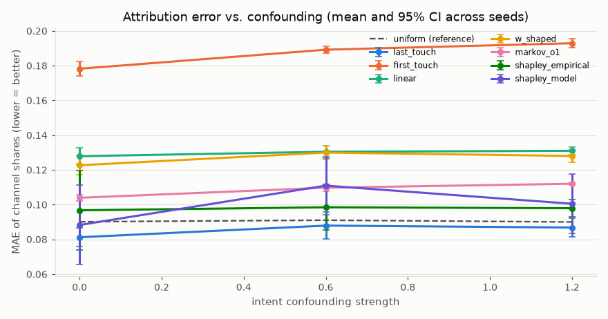
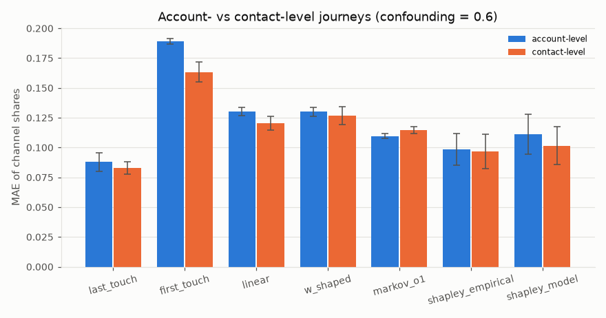
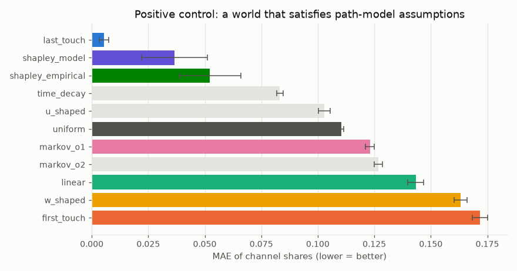
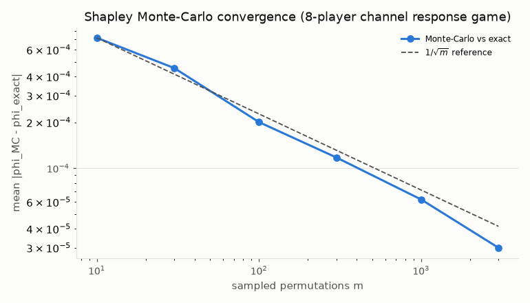
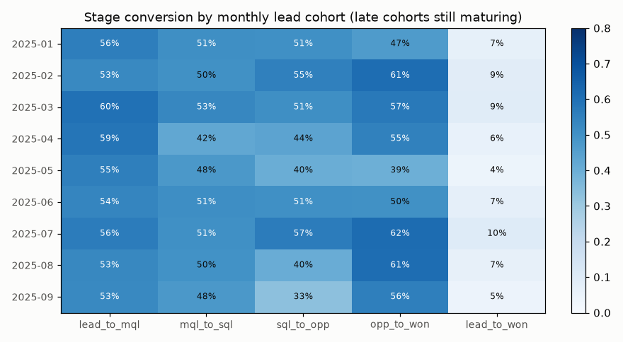
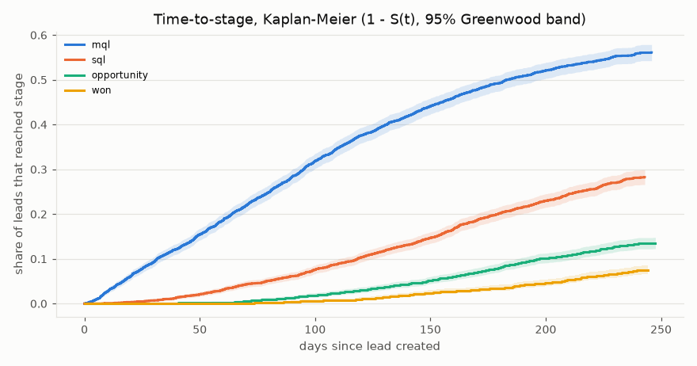

# gtm-attribution-lab report

> **Synthetic data.** All data in this report is SYNTHETIC, generated by gtm-attribution-lab with a known causal ground truth. Numbers describe the simulator, not any real company.

## 1. Data and identity resolution

27,759 web sessions, of which 21,042 (76%) were stitched to a known contact; 6,334 sessions landed as 'direct' (missing UTM/referrer or genuinely untracked). 2,108 contacts were matched to accounts by email domain and 1,207 stayed unresolved. Realised wins in this run: 211; expected wins under the simulator: 223.4.

| channel | touchpoints | accounts_touched | touches_in_won_paths |
| --- | --- | --- | --- |
| outbound_email | 8001 | 2740 | 589 |
| paid | 6098 | 2143 | 645 |
| organic | 4987 | 1984 | 524 |
| direct | 4277 | 2014 | 393 |
| sdr_call | 4197 | 1940 | 349 |
| linkedin | 3442 | 1609 | 267 |
| webinar | 2111 | 1467 | 195 |
| events | 1565 | 1141 | 117 |

## 2. Who gets the credit? (single run, account level)

Ground truth is the share of expected wins that disappear when a channel's touches are removed from the simulator (common-random-number counterfactual). Model shares exclude credit given to 'direct', which has no causal ground truth.

| model | outbound_email | linkedin | paid | webinar | organic | sdr_call | events |
| --- | --- | --- | --- | --- | --- | --- | --- |
| GROUND TRUTH | 0.179 | 0.061 | 0.050 | 0.265 | 0.000 | 0.233 | 0.211 |
| first_touch | 0.346 | 0.078 | 0.464 | 0.039 | 0.067 | 0.000 | 0.006 |
| last_touch | 0.088 | 0.039 | 0.110 | 0.105 | 0.193 | 0.298 | 0.166 |
| linear | 0.260 | 0.088 | 0.214 | 0.079 | 0.178 | 0.134 | 0.047 |
| markov_o1 | 0.202 | 0.133 | 0.187 | 0.103 | 0.156 | 0.134 | 0.086 |
| markov_o2 | 0.198 | 0.128 | 0.182 | 0.104 | 0.160 | 0.141 | 0.086 |
| shapley_empirical | 0.209 | 0.057 | 0.156 | 0.121 | 0.191 | 0.187 | 0.080 |
| shapley_model | 0.139 | 0.000 | 0.197 | 0.173 | 0.207 | 0.232 | 0.052 |
| time_decay | 0.125 | 0.059 | 0.121 | 0.092 | 0.205 | 0.274 | 0.123 |
| u_shaped | 0.226 | 0.065 | 0.268 | 0.074 | 0.144 | 0.146 | 0.076 |
| w_shaped | 0.284 | 0.072 | 0.262 | 0.107 | 0.117 | 0.112 | 0.047 |

## 3. Validation across seeds and confounding levels

MAE = mean absolute difference between a model's channel shares and the true incremental shares; Spearman = rank agreement. Intervals are 95% t-intervals across seeds. 'uniform' gives every channel the same share and is the bar a model must clear to be informative.

| confounding | model | n_seeds | MAE (95% CI) | Spearman (95% CI) | direct share |
| --- | --- | --- | --- | --- | --- |
| 0.000 | last_touch | 8 | 0.081 [0.076, 0.086] | 0.12 [0.06, 0.17] | 0.156 |
| 0.000 | time_decay | 8 | 0.083 [0.079, 0.087] | -0.08 [-0.21, 0.04] | 0.142 |
| 0.000 | shapley_model | 8 | 0.088 [0.065, 0.111] | 0.59 [0.34, 0.84] | 0.195 |
| 0.000 | uniform | 8 | 0.090 [0.089, 0.091] | n/a | 0.000 |
| 0.000 | shapley_empirical | 8 | 0.097 [0.074, 0.119] | 0.28 [-0.01, 0.57] | 0.178 |
| 0.000 | markov_o2 | 8 | 0.103 [0.100, 0.105] | -0.57 [-0.59, -0.56] | 0.139 |
| 0.000 | markov_o1 | 8 | 0.104 [0.102, 0.106] | -0.58 [-0.59, -0.57] | 0.139 |
| 0.000 | u_shaped | 8 | 0.117 [0.112, 0.121] | -0.47 [-0.52, -0.41] | 0.140 |
| 0.000 | w_shaped | 8 | 0.123 [0.117, 0.128] | -0.26 [-0.43, -0.09] | 0.138 |
| 0.000 | linear | 8 | 0.128 [0.123, 0.133] | -0.50 [-0.58, -0.43] | 0.128 |
| 0.000 | first_touch | 8 | 0.178 [0.174, 0.182] | -0.37 [-0.44, -0.31] | 0.131 |
| 0.600 | last_touch | 8 | 0.088 [0.080, 0.096] | 0.23 [0.19, 0.27] | 0.149 |
| 0.600 | uniform | 8 | 0.091 [0.090, 0.092] | n/a | 0.000 |
| 0.600 | time_decay | 8 | 0.094 [0.091, 0.097] | 0.05 [-0.05, 0.15] | 0.128 |
| 0.600 | shapley_empirical | 8 | 0.098 [0.085, 0.111] | -0.28 [-0.56, 0.00] | 0.132 |
| 0.600 | markov_o2 | 8 | 0.107 [0.105, 0.109] | -0.55 [-0.61, -0.49] | 0.137 |
| 0.600 | markov_o1 | 8 | 0.110 [0.108, 0.112] | -0.63 [-0.67, -0.58] | 0.138 |
| 0.600 | shapley_model | 8 | 0.111 [0.094, 0.128] | -0.10 [-0.34, 0.14] | 0.121 |
| 0.600 | u_shaped | 8 | 0.119 [0.115, 0.122] | -0.55 [-0.62, -0.49] | 0.141 |
| 0.600 | w_shaped | 8 | 0.130 [0.126, 0.134] | -0.50 [-0.65, -0.36] | 0.137 |
| 0.600 | linear | 8 | 0.130 [0.127, 0.134] | -0.53 [-0.58, -0.48] | 0.121 |
| 0.600 | first_touch | 8 | 0.189 [0.187, 0.191] | -0.62 [-0.65, -0.59] | 0.144 |
| 1.200 | last_touch | 8 | 0.087 [0.081, 0.092] | 0.23 [0.14, 0.33] | 0.125 |
| 1.200 | uniform | 8 | 0.090 [0.089, 0.091] | n/a | 0.000 |
| 1.200 | time_decay | 8 | 0.095 [0.092, 0.099] | -0.05 [-0.14, 0.03] | 0.113 |
| 1.200 | shapley_empirical | 8 | 0.098 [0.093, 0.103] | -0.17 [-0.36, 0.02] | 0.122 |
| 1.200 | shapley_model | 8 | 0.101 [0.084, 0.118] | 0.05 [-0.26, 0.36] | 0.086 |
| 1.200 | markov_o2 | 8 | 0.108 [0.107, 0.110] | -0.55 [-0.61, -0.49] | 0.136 |
| 1.200 | markov_o1 | 8 | 0.112 [0.111, 0.113] | -0.58 [-0.63, -0.53] | 0.136 |
| 1.200 | u_shaped | 8 | 0.120 [0.117, 0.124] | -0.47 [-0.58, -0.37] | 0.129 |
| 1.200 | w_shaped | 8 | 0.128 [0.125, 0.131] | -0.39 [-0.50, -0.28] | 0.135 |
| 1.200 | linear | 8 | 0.131 [0.129, 0.133] | -0.55 [-0.62, -0.47] | 0.114 |
| 1.200 | first_touch | 8 | 0.193 [0.190, 0.196] | -0.57 [-0.64, -0.50] | 0.143 |

## 4. Account-level vs contact-level journeys

Contact-level journeys only follow the opportunity's primary contact, so touches on the rest of the buying committee are invisible to the model.

| confounding | model | n_seeds | MAE (95% CI) | Spearman (95% CI) | direct share |
| --- | --- | --- | --- | --- | --- |
| 0.000 | last_touch | 8 | 0.085 [0.080, 0.091] | -0.12 [-0.33, 0.10] | 0.142 |
| 0.000 | time_decay | 8 | 0.088 [0.081, 0.095] | -0.16 [-0.35, 0.03] | 0.137 |
| 0.000 | uniform | 8 | 0.090 [0.089, 0.091] | n/a | 0.000 |
| 0.000 | shapley_model | 8 | 0.104 [0.088, 0.121] | 0.25 [-0.01, 0.51] | 0.181 |
| 0.000 | markov_o2 | 8 | 0.110 [0.106, 0.115] | -0.53 [-0.59, -0.47] | 0.139 |
| 0.000 | shapley_empirical | 8 | 0.111 [0.103, 0.119] | -0.07 [-0.37, 0.24] | 0.133 |
| 0.000 | markov_o1 | 8 | 0.115 [0.111, 0.118] | -0.57 [-0.59, -0.55] | 0.138 |
| 0.000 | u_shaped | 8 | 0.119 [0.114, 0.124] | -0.46 [-0.58, -0.34] | 0.130 |
| 0.000 | linear | 8 | 0.123 [0.119, 0.128] | -0.46 [-0.63, -0.30] | 0.123 |
| 0.000 | w_shaped | 8 | 0.126 [0.122, 0.130] | -0.29 [-0.45, -0.14] | 0.130 |
| 0.000 | first_touch | 8 | 0.155 [0.152, 0.159] | -0.24 [-0.39, -0.08] | 0.125 |
| 0.600 | last_touch | 8 | 0.083 [0.078, 0.088] | -0.01 [-0.11, 0.09] | 0.129 |
| 0.600 | time_decay | 8 | 0.084 [0.078, 0.091] | -0.13 [-0.25, -0.02] | 0.122 |
| 0.600 | uniform | 8 | 0.091 [0.090, 0.092] | n/a | 0.000 |
| 0.600 | shapley_empirical | 8 | 0.097 [0.082, 0.111] | -0.11 [-0.33, 0.12] | 0.115 |
| 0.600 | shapley_model | 8 | 0.102 [0.086, 0.117] | -0.04 [-0.27, 0.18] | 0.097 |
| 0.600 | markov_o2 | 8 | 0.112 [0.109, 0.116] | -0.57 [-0.63, -0.50] | 0.131 |
| 0.600 | markov_o1 | 8 | 0.115 [0.112, 0.118] | -0.57 [-0.64, -0.51] | 0.133 |
| 0.600 | u_shaped | 8 | 0.116 [0.108, 0.124] | -0.36 [-0.44, -0.28] | 0.120 |
| 0.600 | linear | 8 | 0.121 [0.115, 0.126] | -0.41 [-0.49, -0.32] | 0.113 |
| 0.600 | w_shaped | 8 | 0.127 [0.119, 0.134] | -0.38 [-0.54, -0.21] | 0.119 |
| 0.600 | first_touch | 8 | 0.163 [0.155, 0.172] | -0.54 [-0.62, -0.45] | 0.118 |
| 1.200 | uniform | 8 | 0.090 [0.089, 0.091] | n/a | 0.000 |
| 1.200 | last_touch | 8 | 0.091 [0.086, 0.095] | 0.06 [-0.03, 0.16] | 0.104 |
| 1.200 | time_decay | 8 | 0.091 [0.088, 0.095] | -0.09 [-0.16, -0.02] | 0.099 |
| 1.200 | shapley_empirical | 8 | 0.093 [0.086, 0.101] | -0.09 [-0.21, 0.03] | 0.091 |
| 1.200 | shapley_model | 8 | 0.108 [0.100, 0.117] | 0.01 [-0.15, 0.18] | 0.066 |
| 1.200 | markov_o2 | 8 | 0.112 [0.109, 0.115] | -0.50 [-0.59, -0.41] | 0.129 |
| 1.200 | markov_o1 | 8 | 0.116 [0.114, 0.119] | -0.50 [-0.58, -0.42] | 0.129 |
| 1.200 | u_shaped | 8 | 0.117 [0.112, 0.123] | -0.35 [-0.51, -0.19] | 0.104 |
| 1.200 | linear | 8 | 0.119 [0.115, 0.123] | -0.36 [-0.45, -0.28] | 0.100 |
| 1.200 | w_shaped | 8 | 0.127 [0.121, 0.133] | -0.37 [-0.49, -0.26] | 0.109 |
| 1.200 | first_touch | 8 | 0.170 [0.164, 0.176] | -0.58 [-0.63, -0.53] | 0.107 |

## 5. Positive control

Same engine, a world built to satisfy path-model assumptions (no confounding, no tracking noise, one effective transition). Models that recover the truth here but not in the realistic world are being broken by the world, not by a bug.

| confounding | model | n_seeds | MAE (95% CI) | Spearman (95% CI) | direct share |
| --- | --- | --- | --- | --- | --- |
| 0.000 | last_touch | 5 | 0.005 [0.003, 0.007] | 0.99 [0.96, 1.01] | 0.000 |
| 0.000 | shapley_model | 5 | 0.037 [0.022, 0.051] | 0.91 [0.84, 0.98] | 0.000 |
| 0.000 | shapley_empirical | 5 | 0.052 [0.039, 0.066] | 0.89 [0.82, 0.97] | 0.000 |
| 0.000 | time_decay | 5 | 0.083 [0.082, 0.085] | 0.71 [0.57, 0.85] | 0.000 |
| 0.000 | u_shaped | 5 | 0.103 [0.100, 0.105] | 0.53 [0.44, 0.62] | 0.000 |
| 0.000 | uniform | 5 | 0.110 [0.109, 0.111] | n/a | 0.000 |
| 0.000 | markov_o1 | 5 | 0.123 [0.121, 0.125] | -0.65 [-0.75, -0.56] | 0.000 |
| 0.000 | markov_o2 | 5 | 0.127 [0.125, 0.128] | -0.68 [-0.71, -0.66] | 0.000 |
| 0.000 | linear | 5 | 0.143 [0.140, 0.147] | -0.72 [-0.77, -0.67] | 0.000 |
| 0.000 | w_shaped | 5 | 0.163 [0.160, 0.166] | -0.85 [-0.93, -0.77] | 0.000 |
| 0.000 | first_touch | 5 | 0.172 [0.168, 0.175] | -0.85 [-0.93, -0.77] | 0.000 |

## 6. Shapley Monte-Carlo convergence

Exact Shapley enumerates 2^n coalitions; with many channels the lab samples permutations instead. Error against the exact solution falls at the expected 1/sqrt(m) rate.

| permutations | mean_abs_error |
| --- | --- |
| 10 | 7.18e-04 |
| 30 | 4.55e-04 |
| 100 | 2.01e-04 |
| 300 | 1.18e-04 |
| 1000 | 6.23e-05 |
| 3000 | 3.00e-05 |

## 7. Funnel conversion by cohort

Monthly lead cohorts, stage-to-stage conversion.

| cohort_month | leads | mqls | sqls | opportunities | wins | lead_to_mql | mql_to_sql | sql_to_opp | opp_to_won | lead_to_won |
| --- | --- | --- | --- | --- | --- | --- | --- | --- | --- | --- |
| 2025-01-01 | 313 | 175 | 89 | 45 | 21 | 0.559 | 0.509 | 0.506 | 0.467 | 0.067 |
| 2025-02-01 | 338 | 178 | 89 | 49 | 30 | 0.527 | 0.500 | 0.551 | 0.612 | 0.089 |
| 2025-03-01 | 375 | 225 | 120 | 61 | 35 | 0.600 | 0.533 | 0.508 | 0.574 | 0.093 |
| 2025-04-01 | 286 | 168 | 71 | 31 | 17 | 0.587 | 0.423 | 0.437 | 0.548 | 0.059 |
| 2025-05-01 | 359 | 199 | 95 | 38 | 15 | 0.554 | 0.477 | 0.400 | 0.395 | 0.042 |
| 2025-06-01 | 347 | 186 | 95 | 48 | 24 | 0.536 | 0.511 | 0.505 | 0.500 | 0.069 |
| 2025-07-01 | 323 | 182 | 92 | 52 | 32 | 0.563 | 0.505 | 0.565 | 0.615 | 0.099 |
| 2025-08-01 | 337 | 179 | 89 | 36 | 22 | 0.531 | 0.497 | 0.404 | 0.611 | 0.065 |
| 2025-09-01 | 322 | 170 | 81 | 27 | 15 | 0.528 | 0.476 | 0.333 | 0.556 | 0.047 |

## 8. Pipeline velocity

Velocity = (# opportunities x win rate x average won ACV) / average days from opportunity creation to closed-won. Win rate uses closed deals only. Quarterly rows group opportunities by creation quarter; recent quarters are right-censored.

| grain | period | n_opportunities | n_closed | n_won | avg_acv | avg_cycle_days | win_rate | velocity_per_day |
| --- | --- | --- | --- | --- | --- | --- | --- | --- |
| all_time | NaT | 387 | 328 | 211 | 63,364 | 36.465 | 0.643 | 432,600 |
| quarter | 2025-01-01 | 2 | 2 | 2 | 86,636 | 29.390 | 1.000 | 5,896 |
| quarter | 2025-04-01 | 44 | 44 | 34 | 79,480 | 31.690 | 0.773 | 85,274 |
| quarter | 2025-07-01 | 134 | 134 | 80 | 58,562 | 45.120 | 0.597 | 103,834 |
| quarter | 2025-10-01 | 119 | 107 | 64 | 61,832 | 34.959 | 0.598 | 125,891 |
| quarter | 2026-01-01 | 88 | 41 | 31 | 59,739 | 22.930 | 0.756 | 173,347 |

## 9. Time-to-stage (Kaplan-Meier)

Accounts that have not reached a stage by the data cutoff are right-censored rather than counted as failures, which is what keeps young cohorts from dragging the curve down. Median is n/a where fewer than half of leads ever reach the stage.

| stage | reached_by_day_90 | reached_by_day_180 | median_days | events |
| --- | --- | --- | --- | --- |
| mql | 0.283 | 0.493 | 183.052 | 1662 |
| sql | 0.061 | 0.202 | n/a | 821 |
| opportunity | 0.013 | 0.080 | n/a | 387 |
| won | 0.004 | 0.035 | n/a | 211 |
